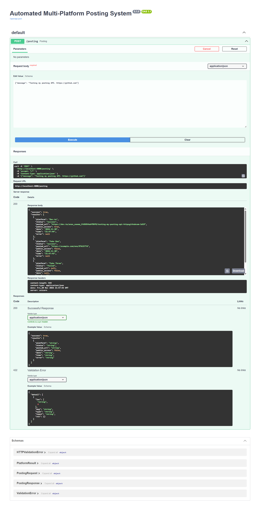
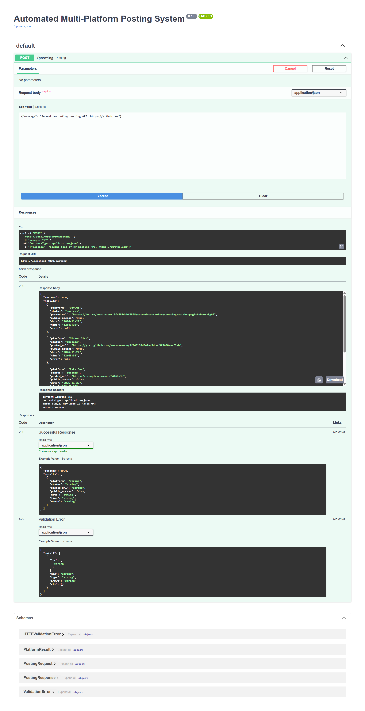
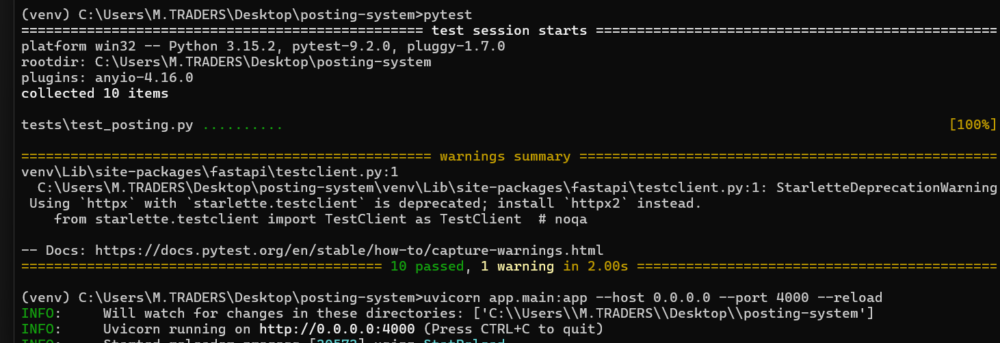

# Automated Multi-Platform Posting System

A FastAPI service that publishes one short message to **5 third-party platforms** through their official APIs, then reports the result for each platform separately.

## Features
- `POST /posting` takes a message and posts it everywhere at the same time (`asyncio.gather`)
- **One failure never stops the others.** Each platform is isolated and reports its own status
- Input validation: max 200 characters, exactly one valid `http(s)` link
- Honest results: after posting, the service opens the new URL to check it is really public
- Credentials only in environment variables (`.env`), never in the code
- 10 automated tests (fake platforms, so tests never touch real sites)

## Platforms
| Platform | API used | Credential |
|---|---|---|
| Dev.to | Forem API `POST /api/articles` | `DEVTO_API_KEY` |
| GitHub Gist | `POST /gists` | `GITHUB_TOKEN` (classic, `gist` scope) |
| Bluesky | AT Protocol `createSession` + `createRecord` | `BLUESKY_HANDLE`, `BLUESKY_APP_PASSWORD` |
| dpaste | `POST /api/v2/` | none |
| Discord | Webhook | `DISCORD_WEBHOOK_URL` |

Discord posts to a private test server, so it correctly reports `public_access: false`.

## Setup
Requires Python 3.10+.

```bash
git clone https://github.com/anasnaeemqu/automated-posting.git
cd automated-posting
python -m venv venv
venv\Scripts\activate          # Windows  (Mac/Linux: source venv/bin/activate)
pip install -r requirements.txt
```

Create your credentials file and fill it in:
```bash
copy .env.example .env         # Mac/Linux: cp .env.example .env
```

| Variable | Where to get it |
|---|---|
| `DEVTO_API_KEY` | dev.to, Settings, Extensions, generate API key |
| `GITHUB_TOKEN` | GitHub, Settings, Developer settings, Tokens (classic), tick only `gist` |
| `BLUESKY_HANDLE` | your handle, e.g. `name.bsky.social` |
| `BLUESKY_APP_PASSWORD` | Bluesky, Settings, Privacy and security, App passwords |
| `DISCORD_WEBHOOK_URL` | Discord channel, Integrations, Webhooks, Copy URL |

A platform with a missing or wrong credential simply reports `failed`; the others still post.

## Run
```bash
uvicorn app.main:app --host 0.0.0.0 --port 4000
```
Interactive docs: http://localhost:4000/docs

## Sample request
```bash
curl -X POST http://localhost:4000/posting \
  -H "Content-Type: application/json" \
  -d '{"message": "Final test of my posting API. https://github.com"}'
```

## Sample response (real run)
```json
{
  "success": true,
  "results": [
    {
      "platform": "Dev.to",
      "status": "success",
      "posted_url": "https://dev.to/anas_naeem_1fd5854abf98f8/final-test-of-my-posting-api-httpsgithubcom-9fn",
      "public_access": true,
      "date": "2026-11-22",
      "time": "16:56:47",
      "error": null
    },
    {
      "platform": "GitHub Gist",
      "status": "success",
      "posted_url": "https://gist.github.com/anasnaeemqu/7e0344d7b67a3afa96de3bd7c0320f4d",
      "public_access": true,
      "date": "2026-11-22",
      "time": "16:56:49",
      "error": null
    },
    {
      "platform": "Bluesky",
      "status": "success",
      "posted_url": "https://bsky.app/profile/zainnaeem.bsky.social/post/3n2w3ikyqcu2d",
      "public_access": true,
      "date": "2026-11-22",
      "time": "16:56:49",
      "error": null
    },
    {
      "platform": "dpaste",
      "status": "success",
      "posted_url": "https://dpaste.com/5DEZ7MY9D",
      "public_access": true,
      "date": "2026-11-22",
      "time": "16:56:49",
      "error": null
    },
    {
      "platform": "Discord",
      "status": "success",
      "posted_url": "https://discord.com/channels/1574097618575954090/1574097619494371394/1574106392304820244",
      "public_access": false,
      "date": "2026-11-22",
      "time": "16:56:49",
      "error": null
    }
  ]
}
```
Times are UTC.

## A platform failing does not stop the others (real run)
Here the Dev.to key was invalid, yet the other platforms still posted:
```json
{
  "platform": "Dev.to",
  "status": "failed",
  "posted_url": null,
  "public_access": false,
  "date": null,
  "time": null,
  "error": "Dev.to error 401: {\"error\":\"unauthorized\",\"status\":401}"
}
```

## Validation
Invalid input returns **422** with a clear message:

| Input | Result |
|---|---|
| `"Hello, no link here"` | 422: must contain exactly one link |
| two links in the message | 422: must contain exactly one link |
| `"see https://"` | 422: not a valid URL |
| over 200 characters | 422: must not exceed 200 characters |
| empty message | 422 |

## Screenshots




## Tests
```bash
pytest
```
Tests replace the real platforms with fakes (one succeeds, one succeeds, one fails on purpose), so they are fast and never post anything.

## Project structure
```
app/
  main.py                  POST /posting endpoint
  schemas.py               request validation + response models
  config.py                reads credentials from environment variables
  platforms/
    base.py                Platform interface (one class per platform)
    devto.py gist.py bluesky.py dpaste.py discord.py
    simulated.py           fake platforms, used by tests
  services/
    posting_service.py     sends to all platforms concurrently, collects results
tests/test_posting.py
.env.example
```

## Design decisions
- **One class per platform** behind a common interface. Adding a platform means one new file and one line in `app/platforms/__init__.py`.
- **`asyncio.gather` + a try/except per platform**: platforms run concurrently and failures are isolated.
- **Never trust a "success" blindly.** While testing, one anonymous-posting service answered `201 Created` but actually blocked the post (spam filter, link in the body). I dropped that platform and added a check that opens each posted URL, so `public_access` reflects reality.
- **Platform selection.** I tested which APIs were reachable from my network and which allow instant access without approval. Telegraph and Telegram timed out, and Mastodon blocked registration from my network, so they were replaced.
- **Certificates.** dpaste failed Python's default TLS check, so requests use the operating system's trust store (`truststore`) instead of disabling verification.

## Limitations and next steps
- Posts are not retried on temporary errors.
- Results are not stored; each request is independent.
- With more time: retries with backoff, per-platform rate limiting, and a stored history.